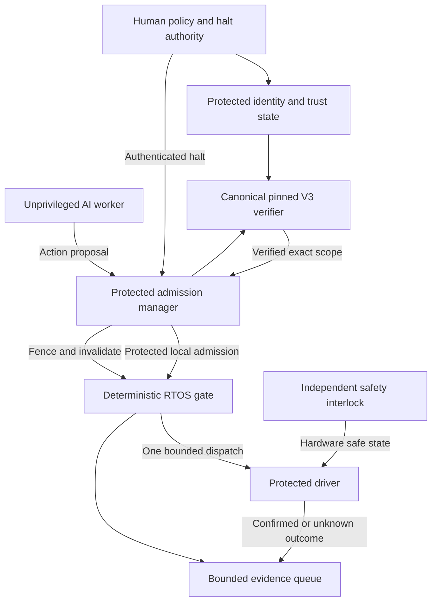

# Deterministic RTOS execution foundation

11 October 2026. Implemented reference code; hardware qualification remains open.

SWOOSH can actively govern AI-driven work when its protected broker owns every route to a consequential effect. It need not predict model intent or run an AI model. The management path authenticates the principal and obtains canonical pinned Action V3 ALLOW. The local execution path admits a bounded, one-use command and rechecks session, identity, role, task generation, exact action/effect commitments, policy/epoch and expiry immediately before the protected driver accepts it.

## Implemented and tested

| Component | Actual implementation | Evidence |
| --- | --- | --- |
| Canonical authority | Existing Rust verifier and signed V3 contract | Full native ALLOW plus 14 authority/binding DENYs |
| Default host SDK | `InstalledTrustContext`; raw free evaluator now requires explicit `raw-compatibility` feature | Default workspace checks and explicit compatibility check in CI; attacker self-signed root regression |
| Bounded gate | `rtos/src/swoosh_gate.c` | Fixed arrays, no allocation, I/O, model inference or cryptographic reimplementation |
| Active authority closure | Halt invalidates all live admissions; resume never restores them | Gate regression and FreeRTOS task test |
| Dispatch serialization | Same protected lock spans final check, one-use consumption, evidence reservation and bounded driver callback | FreeRTOS broker adapter critical section |
| Outcome handling | Failed/unknown responses consume admission and require separate reconciliation | Adversarial gate tests |
| RTOS integration | Single-core FreeRTOS task/critical-section adapter | Real FreeRTOS V11.1.0 POSIX scheduler/queues with broker and worker tasks |
| Canonical bridge | `scripts/verify-native-rtos-gate.py` | Actual pinned native verifier receipt enters the C gate; changed effect/replay/halt produce zero extra effects |

FreeRTOS test dependency: `FreeRTOS/FreeRTOS-Kernel`, V11.1.0, exact commit `dbf70559b27d39c1fdb68dfb9a32140b6a6777a0`, MIT. It is fetched separately for simulation; no vendor kernel source is copied into SWOOSH. This fixed simulation dependency is not an endorsement of that version for a new hardware deployment; a supported MCU port and its current advisories must be evaluated during board qualification. SWOOSH gate/port/test files remain MPL-2.0; this document remains Apache-2.0. The canonical Rust kernel remains unchanged.

## Authority path



The diagram includes the required independent safety interlock; it is not implemented by the portable gate. Management/identity transport is a commissioning boundary, not a public unsigned-admission endpoint. Observability and model quality services may request stop/review; they cannot create an ALLOW or silently resume the gate.

## Gate invariants and limits

1. Every public C entry is a **privileged broker API**. A worker never calls `admit_verified`, `resume`, epoch publication or a driver callback directly. Naming a struct "VerifiedAdmission" is not cryptographic verification.
2. Admission follows a successful canonical V3 evaluation against installed, externally pinned state and the current authoritative epoch floor. Model output, a raw pack chosen by a worker and an unsigned remote receipt are insufficient. The default SDK no longer exports the legacy raw evaluator without an explicit feature; the low-level kernel remains available for trusted integrations.
3. The protected driver/adapter copies and validates the actual payload, derives its effect commitment, binds the resource/action to the canonical action digest, and obtains principal/role from a protected identity channel. Comparing a worker-provided digest with itself is insufficient. The generic gate operates on these commitments; it is not a payload codec.
4. All `_locked` operations share one serialization boundary. The FreeRTOS reference supports a **single core** and broker task calls only. Driver callbacks must be trusted, nonblocking and bounded. No flash write, network operation, allocator, model or SQLite/subprocess call belongs in this critical section.
5. Halt closes admission before acknowledgements say "effective". Dispatch already admitted before halt may already have happened. Device cancellation/reversal is a separate resource-specific operation.
6. Admissions are one-use and never revive on resume. A new admitted generation must exceed the retained task generation; a revocation reserves its own generation. Generation values must never wrap or reset through a restore.
7. A trusted **64-bit monotonic clock** is injected into the FreeRTOS adapter. Zero-extension of a wrapping 32-bit tick source is insufficient. Rollback halts the gate; overflow/fault must enter a board-defined safe state. The POSIX test uses a 64-bit tick counter.
8. Capacity is explicit: 16 retained task slots and 32 evidence records. Completed task slots are retained as replay tombstones; they are not automatically reused. Capacity/evidence exhaustion denies subsequent effects. Production sizing/rollover requires an authenticated durable generation/replay journal. The reference capacity is not enterprise throughput.
9. Init starts halted and the FreeRTOS broker task is bound before scheduling. A fresh, protected boot/session nonce invalidates previous-session requests. The host must retain consumed actions and generation floors across restart: revalidating the same unexpired signed action and repackaging it with a new nonce must not bypass a replay journal.
10. Events are bounded in-memory records, not signed durable audit. The evidence consumer must protect records and anchor them externally before declaring durable proof. Power loss during a driver effect requires a durable intent/outcome journal and an idempotent resource or reconciliation.

## Required physical boundary

For a Cortex-M target, select a supported FreeRTOS MPU port with wrappers V2 and access-control lists. Broker state, signer/channel material, driver objects and MMIO belong to privileged protected memory. Workers receive only their own bounded proposal queue and permitted data; use distinct actor channels and do not trust a claimed task handle. `PRIVILEGED_DATA`/`PRIVILEGED_FUNCTION` declarations aid the selected port but do not configure the MPU by themselves. Block driver access through all other syscalls, connectors, debug paths, DMA controllers and firmware interfaces. Establish trusted boot/update and a hardware watchdog/interlock appropriate to the device.

The POSIX simulation has no MPU isolation and establishes no physical stop time. Kernel/supervisor compromise remains outside an ordinary RTOS user-mode boundary. Zephyr is an alternative where a protected supervisor broker handles user-mode proposals; its own threat model trusts kernel/supervisor code and does not guarantee protection from priority-based CPU starvation.

## Board engineering and acceptance

| Gate | Required result before hardware claims |
| --- | --- |
| Target selection | Named MCU, board revision, RTOS/port commit, clock source, toolchain, protected operation and maximum stop/admission deadline |
| Complete mediation | Unprivileged worker cannot call driver, write MMIO, access credentials, tamper gate/clock/epoch, or use another route |
| Transport | Mutually authenticated manager/device channel; fresh session and sequence; reordered/replayed admission, epoch and halt rejected |
| WCET | Bound gate + copy/hash + driver admission + interrupt masking/scheduling under specified workloads on target hardware |
| Halt latency | Measure request-to-effective-fence and fence-to-physical-safe-state separately; include queued effects, IRQ load and starvation |
| Reset/recovery | Power-loss fault injection; persistent epoch/generation/consumed-action floors; unknown outcome reconciled without blind retry |
| Independent safety | Emergency stop/watchdog/safe-state functions remain operational with AI, broker or network unavailable |
| Evidence | Durable intent/outcome, signed acknowledgement, independent checkpoints and bounded backpressure tested |
| Review | Human RTOS/security review of the exact shipping source, configuration and binary |

Logical determinism does not establish worst-case execution time. An external observer cannot stop a higher-privilege compromised kernel, revoke data already disclosed, or undo an irreversible physical act. Complete mediation and protected runtime integration make the control architecture feasible; absolute "bulletproof" claims are not supported.

## Run

```bash
bash rtos/tests/run_gate_tests.sh
bash rtos/tests/run_freertos_tests.sh /path/to/pinned/FreeRTOS-Kernel
python scripts/verify-native-rtos-gate.py --tools /path/to/conformance-tools --source-commit FULL_VERIFIED_SOURCE_SHA
```

Primary references: [FreeRTOS MPU access control](https://www.freertos.org/Documentation/02-Kernel/04-API-references/13-FreeRTOS-MPU-specific/05-vGrantAccessTo-and-vRevokeAccessTo), [pinned FreeRTOS kernel](https://github.com/FreeRTOS/FreeRTOS-Kernel/tree/dbf70559b27d39c1fdb68dfb9a32140b6a6777a0), [Zephyr user-mode threat model](https://docs.zephyrproject.org/latest/kernel/usermode/overview.html).
